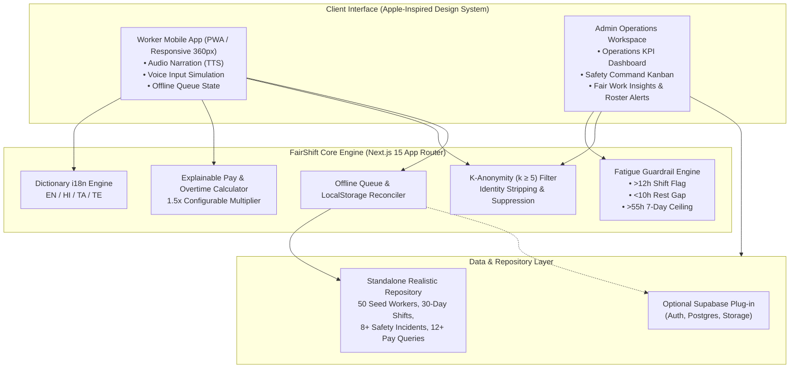

# FairShift (फेयरशिफ्ट / பேர்ஷிப்ட் / ఫెయిర్‌షిఫ్ట్)

> **A Multilingual, Mobile-First Workforce Fairness & Operational Safety Platform for India**  
> *Aligned with UN Sustainable Development Goal 8: Decent Work and Economic Growth (Target 8.8)*

[](https://nextjs.org/)
[](https://www.typescriptlang.org/)
[](https://tailwindcss.com/)
[](https://vitest.dev/)
[](https://sdgs.un.org/goals/goal8)
[](https://cloud.google.com/run)

---

## 📖 Executive Summary

In India's fast-growing economy, over 100 million frontline workers on construction sites, civil projects, healthcare wards, and educational institutions form the backbone of development. However, systemic challenges persist:
1. **Opaque Pay & Overtime:** Frontline workers frequently lack dependable, itemized payslips or transparent records of long overtime hours.
2. **Fear of Retaliation:** When life-threatening safety hazards occur (e.g. unlatched scaffolding, frayed 415V cables, bio-medical PPE shortages, or chemistry lab fume leaks), workers fear losing their daily wage if they speak out.
3. **Severe Duty Fatigue:** Extended 12+ hour concrete foundation pours or consecutive nocturnal hospital shifts create acute cognitive and physical fatigue that triggers preventable accidents.
4. **Digital Literacy & Language Barriers:** Most enterprise HR software is in complex English, requiring reading long blocks of text that fail on basic Android smartphones.

**FairShift** bridges this trust deficit through an Apple-inspired, calm, and accessible dual-interface platform:
- **Worker Experience:** Multilingual (**English, Hindi, Tamil, Telugu**), audio-first (text-to-speech narration), voice input simulation, visual payslips, genuine anonymous reporting, and offline queuing.
- **Employer / Operations Console:** Actionable, privacy-safe intelligence including a Safety Command Center with Kanban triage, non-punitive fatigue guardrails, and mathematically enforced **k-anonymity (k ≥ 5)** that suppresses small feedback groups to eliminate retaliation.

---

## 🏗️ Supported Industry Use Cases (Cross-Industry Architecture)

| Feature Dimension | 1. Construction Sites (Civil / Metro) | 2. Hospitals & Clinical Support | 3. Educational Institutions (Campus Facilities) |
|:---|:---|:---|:---|
| **Frontline Roles** | Scaffolding helpers, masonry assistants, concrete pour crews | Ward housekeeping, attendants, sanitation techs, bio-waste handlers | Campus facilities attendants, hostel upkeep staff, chemistry lab maintenance |
| **Duty Locations** | Station North Yard, tower gates, batching plants, scaffolding bays | ICU wards, post-op recovery, COVID/isolation units, clean utility rooms | NIT Campus Facilities, student hostels, chemistry & electrical laboratories |
| **Hazard Taxonomies** | Loose scaffold clamps, exposed 415V cables, missing chin-strap helmets | Nitrile glove shortages, chemical disinfectant vapors, bio-medical waste segregation | Chemical fume exhaust leaks, faulty eye-wash stations, slippery hostel washrooms |
| **Fatigue Risks** | Single shifts > 12h during concrete foundation curing; weekly hours > 55h | Consecutive night shifts (>3 nights 21:00-06:00) with <10h turnaround recovery | Overtime during semester examination overhaul; prolonged solo laboratory coverage |
| **Verified Skills** | NSDC Level 1 PPE Basics, Safe Scaffolding Erection | NABH Infection Prevention & Control (IPC), Bio-Medical Waste Handling | OSHA Hazardous Chemical Spill Response, Electrical Safety Certification |

---

## 🏛️ System Architecture



---

## 📱 6 Core Frontline Worker Features

1. **Shift Check-in & Offline Queue:**
   - Simulated site QR code scanning, GPS geofence boundary confirmation, or supervisor manual fallback.
   - Shows active shift status, supervisor name, work zone/ward, and scheduled vs logged hours.
   - Automatic local queueing when disconnected, displaying "Offline Saved" and syncing seamlessly upon reconnection.
2. **Transparent Pay & Overtime Wallet:**
   - Visual itemized breakdown of base wages, overtime compensation (1.5x multiplier), travel allowances, and EPF/ESIC social security deductions.
   - Plain-language explanation: *"You completed 24 shifts with 192 regular hours and 28 overtime hours, adding ₹4,620 to your base pay."*
   - Printable / downloadable official HTML payslip view for bank loan verification.
   - Private *"Ask about this pay"* query button to raise clarification tickets.
3. **Safety Reporting & Ground Verification Loop:**
   - 4-step wizard: Hazard category selection, voice note / photo simulation, severity (Low, High, Critical), and default anonymous toggle.
   - 5-stage ticket resolution timeline: *Submitted → Acknowledged → In Progress → Resolved → Verified*.
   - **Worker Ground Verification:** When managers mark a hazard fixed, the worker is prompted: *"Did this fix the problem for you on the ground? Yes / No"*, closing the loop.
4. **Worker Voice & Anonymous Pulse:**
   - 1-to-5 emoji rating for Safety, Supervisor Respect, Workload, Pay Clarity, and Rest.
   - Rapid yes/no questions on shift turnaround and psychological safety.
   - Guaranteed **k-anonymity (k ≥ 5)** ensures individual responses are never isolated.
5. **Fatigue & Fair-Shift Early Alerts:**
   - Non-punitive, explainable alerts for shifts >12h, rest between shifts <10h, or weekly cumulative hours >55h.
   - Includes a *"Why am I seeing this?"* modal with transparent rationale and supervisor rest suggestions.
6. **Portable Skill Passport:**
   - Visual distinction between employer-verified / NSDC-accredited badges and worker self-reported experience.
   - Shareable digital passport card with verification QR code.

---

## 🖥️ 5 Core Employer / Admin Features

1. **Operations Overview Dashboard:**
   - 6 KPI metric cards with one-click transparent *"Why?"* calculation explanations.
   - Spacious Recharts visualizations: Weekly attendance trend, overtime hours by work site, and safety root-cause distribution.
   - Action-oriented *"Priority Actions Required Today"* queue.
2. **Searchable Worker Directory:**
   - Comprehensive directory of 50 seeded workers with sector filters, 7-day cumulative hours, and health signal badges (*Stable*, *Needs Attention*, *High Risk*).
   - Worker detail drawer strictly separating personnel records from anonymous safety reports.
3. **Safety Command Center (Kanban & Table Views):**
   - Drag/click Kanban triage across the 5 lifecycle stages.
   - Assign safety officers, document corrective action steps, and track resolution SLA indicators.
   - Strictly prevents viewing reporter names on anonymous tickets.
4. **Fair Work & Support Signals:**
   - Diagnostic heatmaps for overtime hotspots, back-to-back night shift clusters, and pay query friction.
   - Pairs root causes with concrete supportive recommendations (e.g. *"Deploy hydration canopy"*, *"Mandate 14h rest gap"*, *"Add backup staffing pool"*).
5. **Workforce Rules & Policy Settings:**
   - Configurable standard hours (default 8h), overtime multiplier (default 1.5x), required turnaround rest (default 10h), and k-anonymity floor (default 5).

---

## 👥 Pre-Seeded Demo Personas

On `/login` or via the top header profile pill, switch instantly between:

| Persona | Role & Industry | Work Location | Language | Highlight Scenario |
|:---|:---|:---|:---|:---|
| **Asha Kumar** | Construction Helper | Metro Phase 4 - Station North Yard | Hindi (हिन्दी) | High cumulative duty (58h), Saturday concrete pour overtime clarification query |
| **Ravi Kumar** | Hospital Attendant | Ward 4 & ICU Housekeeping | Tamil (தமிழ்) | Night shifts, ICU risk sanitation allowance, PPE hazard verification |
| **Priya Sharma** | Workforce Operations Admin | Central Operations HQ | English | Full 50-worker directory, Safety Kanban triage, policy engine settings |

---

## 🚀 Local Development Setup

### Prerequisites
- Node.js 20+ or 22+
- npm 10+

### Steps
```bash
# 1. Clone repository
git clone https://github.com/[YOUR-USERNAME]/fairshift-workforce.git
cd "EXE 1"

# 2. Install dependencies
npm install

# 3. Run unit tests
npm test

# 4. Start local development server
npm run dev
```
Open [http://localhost:3000](http://localhost:3000) in your browser.

---

## 🧪 Testing

### 1. Vitest Unit Test Suite
Covers mathematical wage formulas, 1.5x overtime multipliers, explainable fatigue rules, anonymous identity stripping, and k-anonymity suppression:
```bash
npm test
```
*Result: 9 passed across 2 test files in < 2 seconds.*

### 2. Playwright E2E Smoke Test
Simulates the complete frontline-to-admin loop: Worker logs in → checks pay → files anonymous safety report → Admin logs in → verifies report appears in Safety Command Center without worker identity:
```bash
npx playwright test
```

---

## ☁️ Google Cloud Run Deployment

FairShift includes a multi-stage Dockerfile that compiles Next.js in `standalone` mode, binds to `0.0.0.0`, and respects the `$PORT` environment variable.

```bash
# 1. Build and tag the Docker container
docker build -t gcr.io/[PROJECT_ID]/fairshift:latest .

# 2. Push image to Google Artifact Registry / GCR
docker push gcr.io/[PROJECT_ID]/fairshift:latest

# 3. Deploy to Google Cloud Run
gcloud run deploy fairshift \
  --image gcr.io/[PROJECT_ID]/fairshift:latest \
  --platform managed \
  --region asia-south1 \
  --allow-unauthenticated \
  --port 8080
```

---

## 🔒 Security, Privacy & Zero Surveillance

- **K-Anonymity (k ≥ 5):** When aggregating feedback by site or department, if fewer than 5 workers respond, metrics are suppressed to prevent deductive deanonymization.
- **Identity Ingress Stripping:** When a worker selects "Report Anonymously", `workerId` and `workerName` are stripped before being stored.
- **Zero Keystroke / Raw Audio Recording:** Voice simulation transcribes speech locally; raw audio payloads are never permanently stored.
- **No Biometric Storage:** Biometric face or fingerprint templates are deliberately excluded from this prototype.
- **Immutable Audit Logging:** All status modifications to pay and safety tickets record timestamped actor logs.

---

## ⚖️ Important Policy & Advisory Disclaimer
*FairShift provides estimated pay calculations and workforce wellbeing indicators based on configurable workplace policies. It does not provide legal counsel, tax advice, or certified statutory compliance.*

---

## 🗺️ Roadmap & Future Enhancements
- [ ] Integration with India Stack DigiLocker for verifiable NSDC skill credentials.
- [ ] Direct bank account validation via NPCI UPI / IMPS penny-drop verification.
- [ ] Native Android APK wrap via Capacitor / Android CLI with local offline SQLite synchronization.
- [ ] Wearable thermal sensor telemetry for real-time wet-bulb heat index warnings.
